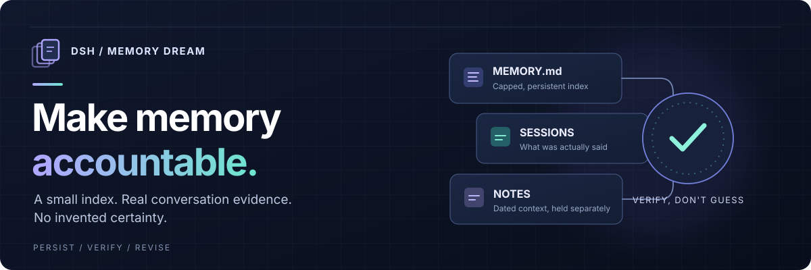

# dsh-memory-dream

**記憶を残すだけでなく、その正しさを問い直す。** [DeepSeek Harness](https://github.com/deepseek-ai/deepseek-harness) 向けのコミュニティ製メモリプラグインです。重要な情報は小さく保ち、詳細は別の層に保存し、実際の会話を根拠に記憶を見直します。

[](https://github.com/Kaito-Rowing/dsh-memory-dream/actions/workflows/test.yml)
[](LICENSE)


[English](README.md) · **日本語** · [技術ガイド](docs/guide.ja.md) · [変更履歴](CHANGELOG.md)

---

## なぜ作ったのか

エージェントは記録を残せます。ただし、**以前の記録が古くなったり、最初から間違っていたことに気づく**のは簡単ではありません。

**dsh-memory-dream は「記憶」と「根拠」を分けて扱います。** 何でも覚え込ませるのではなく、必要な情報を残しつつ、過去の自分を疑えるようにする仕組みです。

| 小さく覚える | 詳細を分ける | 会話で検証する |
|:---|:---|:---|
| 上限付きの `MEMORY.md` を、対応する構成では毎ターン注入。 | トピック別wikiと日付つきノートに詳細を保存。 | 必要なときに `memory_dream` が会話とノートを集め、**モデル**が訂正や保留を判断。 |

## まず使う

既存の DSH プロファイルへインストールします（例は `web`）。

```bash
dsh plugin --profile web add github:Kaito-Rowing/dsh-memory-dream
```

プロファイルを再起動し、**DSH のエージェントとの会話で**次のように頼みます。

> `memory_status` を実行して、このプロファイルで記憶の自動注入が有効か確認して。

その後、秘密ではない簡単な好みを `memory` で記録し、読み返してみてください。標準の保存先は `~/.dsh/memory/`（または `$DSH_HOME/memory/`）です。

**動作環境:** DeepSeek Harness、Node.js 20以上。**zstd形式の会話ログを読むには Node.js 22.15以上**が必要です。Node 20でもプラグイン自体は動作しますが、会話ログを使うdream検証は利用できません。毎ターンの注入には DSH の `systemPrompt` サービスが必要で、存在しない構成でもツールは使えます。

## 仕組み


**自動で行う処理と、エージェントが要求する処理は別です。**

1. **毎ターン（対応する構成の場合）：** `MEMORY.md` とwikiのトピック一覧をモデルのコンテキストに渡します。インデックスの文字数上限は標準で **4,000文字**。
2. **必要なとき：** `memory_dream` が現在の記憶、取得可能な会話ログ、ノート、過去のdream記録を材料として返します。**判断するのはモデル**です。根拠があれば記憶ツールで訂正し、dreamの記録を残せます。決着できない矛盾は勝手に解消しません。

### 保存される場所

| 場所 | 役割 |
|---|---|
| `memory/MEMORY.md` | 小さな索引。文字数上限あり |
| `memory/wiki/<topic>.md` | トピック別の詳細情報 |
| `memory/notes/YYYY-MM-DD.md` | 日付つき作業ノート |
| `sessions/` | DSHが保存する会話の証拠 |
| `memory/dreams/YYYY-MM-DD.md` | 検証結果の履歴。追記型 |
| `memory/dreams/SYNTHESIS.md` | 更新できる現在の指針 |

特に断りがなければ `~/.dsh/` 以下のパスです。`MEMORY.md` は無限の会話アーカイブではなく、上限によって古い内容の統合や整理を促します。

## 使えるツール

| ツール | できること |
|---|---|
| `memory` | 索引への追加・修正・削除（ひとつのoperationsバッチで処理） |
| `memory_note` | 日付つきノートへ追記 |
| `memory_wiki` | トピックページを読み取り・全文置換 |
| `memory_dream` | 検証材料を集め、任意でdream記録・指針を書き込み |
| `memory_status` | 使用量、注入状態、ロック状態を確認 |
| `memory_audit` | プロンプトインジェクションの疑いを検査 |

**dream実行例**（エージェントに送る文章です）。

> `memory_dream` を使い、今の記憶を最近の会話と照合して。根拠のある誤りだけを訂正し、判断できない食い違いは保留として記録して。何をなぜ変更したか、日付つきのdreamに残して。

`memory_dream` 自体がモデルを動かすわけではありません。定期実行したい場合は、DSH のスケジュールからエージェントへこのような指示を送ります。

## 設定

初期設定のまま使えます。変更する場合は、DSHの構成にプラグイン設定を追加します。

```yaml
- id: memory-dream
  name: dsh-memory-dream
  config:
    memoryCharLimit: 4000
    lookbackDays: 14
    inject: true
    transcripts: true
    transcriptsSameWorkspace: true
    scanInjection: true
    log: false
```

全項目、ローカルログ、dreamの定期実行、セッション移行の詳細は [技術ガイド](docs/guide.ja.md#設定) を参照してください。

## 知っておきたい制限

- **ワークスペースの分離:** 既定の `transcriptsSameWorkspace: true` では、現在のワークスペースに一致する会話がなくても、**他のワークスペースの会話は読みません**。証拠がないことを報告します。全ワークスペースを明示的に対象にしたい場合のみ `transcriptsSameWorkspace: false` を設定してください。
- **プライバシー:** 記憶と会話には機密が含まれる可能性があります。ファイルはローカル保存ですが、モデルに渡る文章は設定済みのモデル提供元によって処理されます。生のデバッグスナップショットは公開しないでください。
- **安全性:** 注入スキャンはヒューリスティックであり、完全な防御ではありません。プロセス間ロックはベストエフォートです。`memory_audit` の `fix: true` を使う前にはバックアップしてください。

利用前に [セキュリティ方針](SECURITY.md)、[既知の制限](docs/guide.ja.md#既知の制限)、[コントリビューション](CONTRIBUTING.md) も確認してください。

---

<sub>MIT License · DeepSeek公式ではない独立したコミュニティプロジェクトです。 · [English](README.md)</sub>
