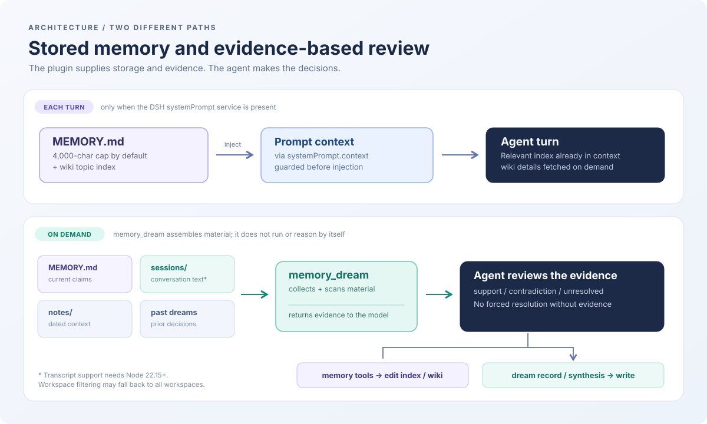

# dsh-memory-dream

[](https://github.com/Kaito-Rowing/dsh-memory-dream/actions/workflows/test.yml)
[](LICENSE)

[English](README.md) | 日本語

**DeepSeek公式ではないコミュニティ製プラグインです。** [DeepSeek Harness](https://github.com/deepseek-ai/deepseek-harness) 向けの階層型エージェント記憶。dream パスで記憶を実際の会話と照合し、証拠で解決できない矛盾はそのまま残します。

## まず使ってみる

**必要な環境:** DeepSeek Harness と設定済みプロファイル（以下の例は `web`）、Node.js 20 以上。**zstd 圧縮されたセッションログの読み取りには Node.js 22.15 以上が必要**です。Node 20 でも記憶ツールは読み込めますが、トランスクリプトに基づく dream の検証は利用できません。

~~~bash
dsh plugin --profile web add github:Kaito-Rowing/dsh-memory-dream
~~~

対象プロファイルを再起動してください。その後、**DSH のエージェントとの会話で**次のように頼みます（ターミナル用コマンドではありません）。

> `memory_status` を実行して、記憶の自動注入が有効か教えてください。

続けて、秘密でない簡単な好みを `memory` ツールで保存してみてください。標準の保存先は `~/.dsh/memory/` です。`memory_dream` は**モデルが検証するための材料**を集めるツールであり、単体で推論したり定期実行したりするものではありません。詳しくは [dream の定期実行](#dream-を定期実行する) を参照してください。

**プライバシー:** 記憶や会話ログには個人情報・機密情報が含まれ得ます。ファイルはローカルに保存されますが、モデルに注入される文章は DSH で設定したモデル提供元によって処理されます。`memory_audit` の `fix: true` など破壊的な操作を試す前に `~/.dsh/memory/` をバックアップしてください。正規表現による注入スキャンは安全性を保証しません。

**ワークスペース間の分離:** 現状、指定ワークスペースのセッションが見つからない場合、**他のワークスペースの会話まで読み取る**フォールバックがあります。厳密な分離が必要なら、動作が変更されるまで `transcripts: false` を設定するか、DSH のホームを分けてください。詳しくは [既知の制限](#既知の制限) を参照してください。

## ドキュメント案内

- [記憶の4層](#実際に何をするか) · [インストール](#インストール) · [ツール一覧](#ツール) · [設定](#設定)
- [dream の定期実行](#dream-を定期実行する) · [テレメトリ](#ローカル開発用テレメトリ) · [既知の制限](#既知の制限)
- [コントリビューション](CONTRIBUTING.md) · [セキュリティ](SECURITY.md) · [変更履歴](CHANGELOG.md) · [ライセンス](LICENSE)

## 設計の概要

[DeepSeek Harness](https://github.com/deepseek-ai/deepseek-harness) のための階層型エージェント記憶。**記憶を実際の会話と突き合わせて検証し**、決着できないものは決着させずに記録する dream パス付き。

多くの記憶プラグインは「もっと覚えさせる」方向に作られています。これは違う問いから始まります。**何を残してよいのか、そしてエージェントは自分が間違っていたことにどう気づくのか。**

設計は Anthropic の記憶階層の説明 — *[The components of agent memory](https://www.anthropic.com/research/components-of-agent-memory)* (2026) — と、Hermes Agent の `MEMORY.md` が使っている上限強制の仕組みに基づいています。



## 実際に何をするか

4 層。小さいものほど高コスト:

| 層 | 場所 | 役割 |
|---|---|---|
| 注入 | `~/.dsh/memory/MEMORY.md` | 今の真実の索引。上限あり。毎ターン読まれる |
| wiki | `~/.dsh/memory/wiki/<topic>.md` | 詳細。1トピック1ページ |
| ノート | `~/.dsh/memory/notes/YYYY-MM-DD.md` | その時エージェントが記録したこと |
| トランスクリプト | `~/.dsh/sessions/` | 実際に交わされた言葉 |

dream が書く 2 つの成果物:

| 成果物 | 場所 | 役割 |
|---|---|---|
| 夢の記録 | `~/.dsh/memory/dreams/YYYY-MM-DD.md` | 履歴。追記のみ、書き換えない |
| 指針 | `~/.dsh/memory/dreams/SYNTHESIS.md` | 現在の指針。自由に書き換える |

## 3 つのアイデア

### 1. 上限が統合を強制する

`MEMORY.md` には文字数上限があります（既定 4,000）。超える書き込みは受け付けず、現在の全エントリをエラーと一緒に返します。

```json
{
  "success": false,
  "error": "MEMORY.md would exceed its limit (4231/4000 chars, 231 over). Retry as ONE operations batch ...",
  "current_entries": ["...", "..."],
  "usage": "4000/4000"
}
```

上限は**バッチの最終結果に対してだけ**判定されます。だからエージェントは、古いエントリを削るか短くして、新しいものを足すところまでを 1 回の呼び出しでやる必要がある。少しずつ足して都度失敗する、という逃げができません。

これは保存容量の制限ではなく、**思考を強制する装置**です。上限に一度も当たらないエージェントは、一度も統合していないエージェントです。

### 2. dream はノートではなく会話を読む

`memory_dream` は 4 つを材料に組み立てます。現在の `MEMORY.md`、**実際のセッショントランスクリプト**、日付つきノート、過去の夢。効くのはトランスクリプトです。これが無いと、同じ会話の要約 2 つを比べることになり、**ずれは見つかっても誤りは見つからない**。

トランスクリプトは `~/.dsh/sessions/` から多フレーム zstd JSONL として読みます。残すのはユーザーとアシスタントのテキストだけ。ツール呼び出し・結果・注入された文脈は捨てます。dream が見るのは**交わされた言葉**で、ツール出力はむしろ証拠として再提示すべきでない不信な材料だからです。

dream のプロンプトは、自分の権限の限界について明示しています。

> - **証拠に反している** — patch し、何がなぜ変わったかを記録する。
> - **決着できない** — 記憶と証拠が食い違い、どちらとも決められない。勝手に決めない。矛盾として夢に記録し、エントリはそのまま残す。
>
> 根拠のない訂正は、行儀のいい作り話でしかない。

Anthropic のポケモン実験が、なぜこれが効くのかの最も明快な例です。あるエージェントは山の入口の目印が東側にあると書き間違えました。訂正しなければ、崖から 3 回落ちて諦めました。トランスクリプトと突き合わせて訂正したら、まっすぐ洞窟に戻って突破しました。生成ではこれを捕まえられません。検証だけが捕まえます。

### 3. 記憶は「読むもの」ではなく「注入されるもの」

`MEMORY.md` は `ctx.systemPrompt.context` 経由でモデルに届きます。エージェントが「見に行こう」と決めなくても、毎ターンそこにあります。wiki のトピック一覧も一緒に載るので、どんな詳細があるかが分かり、必要なら読めます。

注入できるかどうかは構成次第です。`dsh-system-prompt` を持たないツリー — `headless` プロファイルなど — には、貢献するプロンプトがありません。プラグインはそれでもロードされ、全ツールが動きます。`memory_status` が状態を報告します。

```
injection   off — this composition has no systemPrompt service; memory is reachable only through the tools
```

これは意図的です。`inject` に `systemPrompt` を宣言すると必須扱いになり、そういう構成ではプラグイン自体が起動しなくなります。

## 注入スキャン

記憶はプロンプトに読み戻されます。つまりこれは**注入の入口**です。エージェントがウェブページから拾って `MEMORY.md` に書いた文章は、未来の自分への指示になります。

読み取り経路はすべて — 注入される文脈、`memory_wiki` の読み取り、dream の材料、トランスクリプト — **エントリ単位**でスキャンします。ブロック対象のヒットは、パターン名と元の文の在り処を示す印に差し替えます。

```
[BLOCKED: MEMORY.md entry 2 matched injection pattern(s) override, exfil-prompt.
The original text is still on disk and was not loaded.
Run memory_audit to see it, then rewrite or delete the entry.]
```

3 つの判断があります。

- **ファイル単位ではなくエントリ単位。** 汚染された 1 件のために記憶全体を失うべきではない。
- **削除ではなく差し替え。** 元の文はディスクに残ります。誤検知の代償は見える印であって、失われた事実ではありません。
- **2 段階の重大度。** `block` は本文を隠し、`flag` は報告だけします。曖昧な形を隠すと、失うもののほうが大きいからです。

`memory_audit` は全層をスキャンして元の文を見せます。`fix: true` は `MEMORY.md` の該当エントリを削除しますが、wiki やノートには触れません。それは利用者自身の記録です。

**これは網であって保証ではありません。** 正規表現ヒューリスティックは言い換えられた攻撃をすり抜けますし、注入手法を解説する正当な文章を誤検知することもあります。目的は**気づくこと**であって、防ぐことではありません。

## インストール

```bash
dsh plugin --profile web add github:Kaito-Rowing/dsh-memory-dream
```

ローカルのチェックアウトから:

```bash
dsh plugin --profile web add link:/path/to/dsh-memory-dream
```

プロファイルを再起動してください。初回利用時に `~/.dsh/memory/` が作られます。

## ツール

| ツール | 内容 |
|---|---|
| `memory` | `MEMORY.md` に対する `add` / `patch` / `remove`。上限を強制する。 |
| `memory_note` | 日付つきノートに追記。 |
| `memory_wiki` | トピックページの読み書き。`content` を省くと読み取り。 |
| `memory_dream` | 夢の材料を組み立てる。任意で記録と指針を書く。 |
| `memory_status` | 使用量、件数、注入が有効かどうか、ロックの状態。 |
| `memory_audit` | 全層の注入パターン検査。 |

## 設定

```yaml
- id: memory-dream
  name: dsh-memory-dream
  config:
    memoryCharLimit: 4000        # MEMORY.md の上限
    lookbackDays: 14             # ノートとトランスクリプトの窓
    memoryDir: null              # 既定: $DSH_HOME/memory
    scanInjection: true          # モデルに届く前のスキャン
    inject: true                 # 毎ターン MEMORY.md を注入
    injectTopics: true           # wiki のトピック一覧を含める
    transcripts: true            # dream がセッションログを読む
    transcriptMaxChars: 40000    # トランスクリプトの文字数予算
    transcriptsSameWorkspace: true  # 現在のワークスペースのセッションのみ
    language: en                 # ツール文言: en | ja
    log: false                   # ローカル開発用テレメトリ（下記）
```

既定値はすべて、素のインストールでそのまま動きます。不正な値はエラーにせず既定値に戻します。

## dream を定期実行する

DSH の `schedule` サービスは、タイマーで新しいセッションにプロンプトを届けられます。RRULE と、たとえば次のようなプロンプトでタスクを作ります。

```
memory_dream を実行してください。材料を読み、新しい事実を足すのではなく
既にある記述をトランスクリプトと突き合わせて検証してください。証拠に反する
エントリは patch し、詳細は memory_wiki に降ろし、古いものは削除してください。
証拠で決着できない食い違いは、矛盾として記録し、エントリはそのまま残して
ください。それから record パラメータで今日の夢を書いてください: 何を訂正したか、
何が未解決か、明日の最初の一手。memory_audit を実行し、ブロックがあれば
調べてください。
```

毎晩が妥当な既定値です。Anthropic も「適切な頻度は未解決の問題」と書いています。夢が何も見つけなくなったら、頻度を下げてください。

## ローカル開発用テレメトリ

記憶システムのデバッグでは、ツールの戻り値では分からないことを知りたくなります。dream は本当にトランスクリプトを読んだのか、それともフォールバックしたのか。上限で弾かれたのか、書き込みが失敗したのか。あの訂正は本物か、モデルの幻覚か。

`log: true` で構造化イベントをローカルに記録します。**既定は無効**で、リポジトリの外に書き、記録した内容がモデルに戻ることは一切ありません。

```yaml
- id: memory-dream
  name: dsh-memory-dream
  config:
    log: true
    logDir: /home/you/.dsh-memory-dream-logs   # 任意。これが既定の場所
    logDebug: false                            # 追加フィールド。本文は記録しない
    logMaxBytes: 8388608                       # 8 MiB でローテーション
    logMaxFiles: 5                             # ローテーション後の保持数
    logMaxRuns: 100                            # 夢のサマリーの保持数
```

出力は 2 つ。問いが違うからです。

| ファイル | 用途 |
|---|---|
| `events.jsonl` | 1 行 1 JSON。`jq` やスクリプト向け |
| `runs/<runId>.md` | dream 1 回分の人間向けサマリー |

**dream ごとに固有の runId が付きます。** プラグインのインスタンスは「実行」ではありません。長く動くプロセスは何度も夢を見るので、プラグインの id を共有すると全部が 1 つのバケツに入り、同じサマリーファイルを上書きしてしまいます。3 回の夢は 3 つのサマリーを残します。

すべてのイベントに `runId` が付くので、dream 1 回をそれで絞れば再構成できます。

```
09:17:18.097 plugin.start             cap=4000 lookback=14d inject=true
09:17:18.109 memory.write        11ms applied=1 entries=1 usage=24/4000
09:17:18.113 note.append          2ms date=2026-11-09 chars=6
09:17:18.120 audit                    FAIL scanned=4 findings=1 removed=0
09:17:18.121 dream.start              date=2026-11-09 record=true
09:17:18.123 dream.material           memory=2/61c notes=1 sessions=17 transcript=4821c ws=ok blocked=1
09:17:18.125 dream.record             chars=22 appended=false
09:17:18.125 dream.end            4ms record=true synthesis=false
```

`scripts/log-report.mjs` で読めます。

```bash
node scripts/log-report.mjs ~/.dsh-memory-dream-logs            # タイムライン
node scripts/log-report.mjs ~/.dsh-memory-dream-logs --runs     # 実行一覧
node scripts/log-report.mjs ~/.dsh-memory-dream-logs --slow     # 遅い処理
node scripts/log-report.mjs ~/.dsh-memory-dream-logs --run run_x --json
```

### 記録するもの

件数、所要時間、ID、結果、パターン名。具体的には:

- `memory.write` — 操作種別ごとの要求数、適用数、結果のエントリ数と使用量、上限で弾かれたか
- `dream.material` — エントリ数、ノート数、セッション数、トランスクリプト文字数、ワークスペース照合が一致したかフォールバックしたか、ブロックされたエントリ数
- `dream.record` / `dream.synthesis` — 書いた文字数と行数、追記だったか
- `audit` — 層ごとの検出数、重大度、発火したパターン
- `inject.render` — 注入した文脈のサイズとエントリ数
- `lock.degraded` — プロセス間ロックなしで進んだ書き込み
- `wiki.read` / `wiki.write` / `note.append` — トピック、サイズ、ブロックの有無

### 記録しないもの

記憶の本文、wiki の本文、ノートの本文、夢の記録、会話のトランスクリプト、プロンプト、API キー、認証情報。ロガーは全フィールドを無害化します。文字列は 200 文字で切り詰め、配列は上限を設け、深さを制限し、内容を含む固定キー（`text`、`content`、`prompt`、`message`、`memory`、`token`、`apiKey` など）は、呼び出し側が渡してきても `[redacted]` に置き換えます。

`logDebug` はマーカーと追加のタイミング情報を足します。本文の記録を有効にするものではありません。本文を記録するモードは存在しません。

### 安全性

- **ログの失敗が記憶を壊さない。** すべての書き込みを包んであり、パスが壊れていればロガーを無効化し、記憶の操作は続行します。`logDir` をファイルに向けても書き込みが成功することをテストで確認しています。
- **停止したロガーはそう名乗る。** `memory_status` が `stopped — <理由>` と報告します。記録することが無かったロガーと見分けがつかない、という状態を作りません。
- **ファイルは所有者のみ**（POSIX で `0o600`）。
- **ローテーション** は `logMaxBytes` を超えたら回し、`logMaxFiles` を超えた古いファイルを削除します。サマリーは `logMaxRuns` で剪定します。イベントログには上限があり、サマリーには無かったので、長く使うと夢 1 回につき小さなファイルが 1 つずつ無限に溜まっていました。
- **git ワークツリー内のログディレクトリは拒否し、何も書きません。** 場所の検査は非同期なので、ロガーは**停止状態で開始**し、安全なパスだと確認できたときだけ解放します。「off」と報告しながらリポジトリに 1 行書いてしまっている状態は、どちらか一方より悪いからです。`.gitignore` も既定の場所をカバーしています。
- **複数プロセスの追記は安全。** 各イベントは 1 回の `O_APPEND` 書き込みなので、ログディレクトリを共有する 2 プロセスが互いの行を壊しません。ローテーションだけはプロセスごとで調整していませんが、最悪でも「回転したファイルが伸びなくなる」で、行が壊れることはありません。
- **ログは注入されません。** 記憶階層の一部ではなく、プロンプトに読み戻すコードパスは存在しません。

### `dreams/` との関係

`dreams/YYYY-MM-DD.md` は**記憶の成果物**です。エージェントが自分について下した結論で、履歴として残し、後でエージェント自身が読みます。テレメトリログは**開発の成果物**です。プラグインが機械的に何をしたかを、人間がデバッグするために残します。書く場所もコードも別で、どちらも他方から導出されません。

## マシン間でセッションを移す

`scripts/migrate-session.mjs` は、1 つのセッションログを別のマシンにコピーし、
ヘッダの絶対 `cwd` をそのマシンに存在するパスへ書き換えます。記録された cwd が
存在しないセッションは再開できないので、これがログを可搬にする最小の変更です。

```bash
node scripts/migrate-session.mjs \
  ~/.dsh/sessions/--old--/session-abc/session.v4.jsonl.zstd \
  /tmp/session.v4.jsonl.zstd \
  /home/you/project
```

厄介なのは物理フォーマットです。DSH は**最初の zstd フレームがちょうど 1 行**
（ヘッダ）であることを検証し、そうでなければログを拒否します。そのためスクリプトは
ファイル全体を 1 フレームに再エンコードせず、**ヘッダ単独のフレームと残りの
フレームの 2 つ**を書きます。結果を
`~/.dsh/sessions/<エンコードされた cwd>/<セッション id>/` に置き、
`~/.dsh/storages/workspace.json` の対象ワークスペースの `sessionIds` に id を足します。

## データの安全性

- **原子的な置換。** `MEMORY.md`、wiki ページ、夢の記録、指針は、同じディレクトリの一時ファイルに書いてから rename します。書き込み途中のクラッシュで既存ファイルが切り詰められることはありません。
- **追記の直列化。** ノートは置換ではなく追記なので、その意味では原子的ではありません。ただし追記も同じロックを取ります。2 つの追記が同じファイルで競合すると、バイトが混ざりうるからです。
- **ルートごとに 1 ライター。** プロセス内ミューテックスで厳密に直列化します。ロックファイルでプロセス間を調整し、30 秒より古いロックは永久にブロックするのではなく破棄します。
- **ロック失敗は報告される（無音にしない）。** ロックファイルが 5 秒以内に取れない場合、書き込みはそのまま進みます。プロセス内ミューテックスが通常のケースを既にカバーしており、古いロックがあるという理由で記憶の保存を拒否するのは、存在するかどうか分からない競合から守るためにデータを失うことになるからです。劣化は記録され、`memory_status` に表示されます。

  ```
  lock        ok — every write held the cross-process lock
  lock        degraded 1x — last: another process holds the lock
  ```

- **パス検証。** モデルが指定した名前はすべて、パスになる前に検証します。日付は実在する暦日でなければならず（`2026-02-30` も `../../etc/passwd` も失敗します）、トピックは kebab-case、解決後のパスが記憶ルートの下にあることを確認します。
- **0.1 のデータと互換。** 0.1 はエントリ区切りを「次の行の先頭に `§ `」として書いていました。パーサはその形と現在の形の両方を認識するので、既存のストアはそのまま動きます。

## 設計メモ

**なぜトークン予算ではなく文字数上限か。** 文字数は数えるのが安く、決定的で、使用量の行としてモデルにも見えます。トークン予算だと書き込み時にトークナイザが要ります。

**なぜ `memory_dream` は夢を書かずに材料を返すのか。** 書くのはモデルの仕事で、プラグインが推論を装うべきではないから。ツールは入力を組み立てて書き場所を提供し、判断はプロンプトが供給します。

**なぜ `dreams/` と `SYNTHESIS.md` を分けるのか。** 日付つきの夢は履歴で、書き換えるべきではありません。指針は現在の判断で、状況が変われば書き換えるべきです。一緒にすると、履歴を失うか、古い指示を抱え続けるかのどちらかになります。

**なぜ同じ日の 2 回目の dream は上書きではなく追記なのか。** 再実行はたいてい 1 回目の訂正であり、1 回目の結論は「その時何が信じられていたか」の証拠だからです。

## 既知の制限

- **注入には `dsh-system-prompt` が要る。** それを持たない構成（headless）では、ツールは使えますが自動の文脈注入はありません。`memory_status` がそう報告します。
- **トランスクリプトの読み取りはファイルシステム直。** `ctx.sessionQuery` を経由せず JSONL の世代を直接読みます。将来フォーマットが変われば、対応する更新が要ります。読み取り側は保守的で、読めないフレームは飛ばし、書き込みは一切しません。
- **スキャナはヒューリスティック。** 上記のとおりです。
- **`transcriptsSameWorkspace` はエンコードされたディレクトリ名で照合します。** エンコード方式が変わればフィルタは何にも一致しないので、リーダーは全ワークスペースにフォールバックし、そのことを夢の材料に明記します。「読むものが無かった」ように見える空の結果を返す代わりです。
- **プロセス間ロックは勧告的。** OS のアドバイザリロックではなく、ロックファイルです。このプラグインを使う 2 つのプロセスを調整しますが、無関係なプログラムが同じファイルに書くのを止めることはできません。

## ライセンス

MIT


## サポートとリリース

不具合や機能提案は、既存の報告を確認してから [GitHub Issues](https://github.com/Kaito-Rowing/dsh-memory-dream/issues) へお願いします。DSH と Node.js のバージョン、プロファイル、最小再現手順、伏字化済みのエラーを添えてください。**記憶ファイル、生の会話ログ、トークン、非公開のデバッグスナップショットは貼らないでください。** セキュリティに関する報告は公開 Issue ではなく [SECURITY.md](SECURITY.md) に従ってください。

`package.json` のバージョン表記だけでは GitHub Release や npm 公開済みとは限りません。タグとリリースノートを作る前に [CONTRIBUTING.md](CONTRIBUTING.md) のチェックリストを確認してください。
