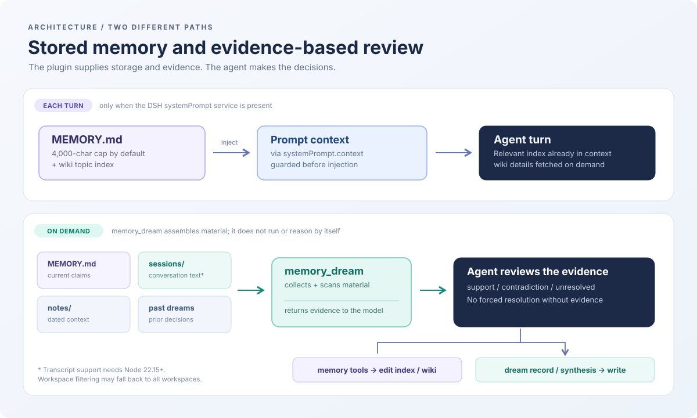

# dsh-memory-dream

English | [日本語](README.ja.md)

Layered agent memory for [DeepSeek Harness](https://github.com/deepseek-ai/deepseek-harness), with a nightly pass that **corrects** what the agent got wrong.

Most memory plugins help an agent remember more. This one is built around a different question: what should be allowed to persist, and how does the agent find out it was wrong?

The design follows Anthropic's published account of agent memory as a hierarchy — *[The components of agent memory](https://www.anthropic.com/research/components-of-agent-memory)* (2026) — and the hard-cap mechanism from Hermes Agent's `MEMORY.md`.



## The hierarchy

```
injected context   ~/.dsh/memory/MEMORY.md          index only, hard cap
      ↕
representations    ~/.dsh/memory/wiki/<topic>.md    detail, one topic per page
      ↕
notes              ~/.dsh/memory/notes/YYYY-MM-DD.md  raw day-to-day
      ↕
transcripts        ~/.dsh/sessions/                 the session log itself
```

Plus two artifacts the dream pass writes:

```
dreams      ~/.dsh/memory/dreams/YYYY-MM-DD.md   historical record, never deleted
synthesis   ~/.dsh/memory/dreams/SYNTHESIS.md    current guidance, rewritten
```

The point of the split: the injected layer stays small, and everything else is reachable but not paid for on every turn.

## Two ideas worth stealing

### 1. The cap forces consolidation

`MEMORY.md` has a character limit (default 4,000). When a write would exceed it, the `memory` tool rejects the write and returns every current entry:

```json
{
  "success": false,
  "error": "MEMORY.md would exceed its limit (4231/4000 chars, 231 over). ...",
  "current_entries": ["...", "..."],
  "usage": "4000/4000"
}
```

The limit is checked only against the **final result of a batch**, so the agent can remove or shorten stale entries and add the new one in a single `operations` call. It cannot dribble entries in and hope.

This is a forcing function, not a storage limit. An agent that never hits the cap is an agent that never consolidates.

### 2. The dream corrects, it does not generate

`memory_dream` returns the current `MEMORY.md` and the last N days of notes as material, and the prompt tells the agent to **verify what is already written** rather than add new facts. The interesting output is a correction:

> The note says the deadline was the 7th; MEMORY.md says the 8th. The 8th came from a rebooking. Patching.

Anthropic's Pokémon experiment is the clearest version of why this matters: an agent wrote down that a landmark was on the east side of a mountain when it was on the west. Uncorrected, it walked off a ledge three times and gave up. Corrected against the transcript, it went straight back in. Generation would not have caught that. Only checking would.

## Injection scanning

Memory is read back into the prompt on later turns. That makes it an injection surface: whatever the agent picks up from a web page and writes into `MEMORY.md` becomes an instruction to its future self.

Every read path scans entry by entry. A hit is replaced, not dropped:

```
[BLOCKED: MEMORY.md matched injection pattern (override, exfil-prompt).
The text was not loaded. If you did not write this, check and delete the entry.]
```

Per-entry rather than per-file, deliberately: one poisoned entry should not cost you the whole store.

Detected: instruction overrides (EN/JA), role reassignment, system-prompt exfiltration, secret exfiltration, permission-grant claims, invisible/bidi characters.

`memory_audit` scans every layer at once and can remove flagged `MEMORY.md` entries with `fix: true`.

**This is a tripwire, not a guarantee.** Regexy heuristics miss paraphrased attacks and will occasionally flag legitimate text (a note *about* injection techniques). The goal is noticing, not blocking.

## Install

```bash
dsh plugin --profile web add github:OWNER/dsh-memory-dream
```

Or from a local checkout:

```bash
dsh plugin --profile web add link:/path/to/dsh-memory-dream
```

Restart the profile. The plugin creates `~/.dsh/memory/` on first use.

## Tools

| Tool | What it does |
|---|---|
| `memory` | `add` / `patch` / `remove` against `MEMORY.md`. Enforces the cap. |
| `memory_note` | Append to today's dated note. |
| `memory_wiki` | Read or write a topic page. Omit `content` to read. |
| `memory_dream` | Return dream material; optionally write `SYNTHESIS.md`. |
| `memory_status` | Usage, counts, and what exists. |
| `memory_audit` | Scan all layers for injection patterns. |

## Config

```yaml
- id: memory-dream
  name: dsh-memory-dream
  config:
    memoryCharLimit: 4000   # cap on MEMORY.md
    lookbackDays: 14        # how many days of notes the dream reads
    memoryDir: null         # default: $DSH_HOME/memory
    scanInjection: true     # set false to disable the scanner
```

## Scheduling the dream

DSH's `schedule` service can deliver a prompt to a fresh session on a timer. Create a task with an RRULE and a prompt like:

```
Run memory_dream. Read the material and verify what is already written
rather than adding new facts. Patch entries that contradict the notes,
move detail into memory_wiki, and remove what is stale. Then write today's
dream: what you corrected, what is unresolved, and tomorrow's first move.
Run memory_audit and investigate anything it flags.
```

Nightly is a reasonable default. Anthropic notes that the right cadence is still an open question — if the dream keeps finding nothing, run it less often.

## Design notes

**Why a cap and not a token budget?** Characters are cheap to count, deterministic, and visible to the model in the usage line. A token budget would need the tokenizer at write time.

**Why per-entry injection scanning?** Because a single bad entry is recoverable and a corrupted store is not. The blocked entry stays visible as a `[BLOCKED: ...]` marker so the agent can see something was removed and why.

**Why separate `dreams/` from `SYNTHESIS.md`?** The dated dream is history — it should never be rewritten. The synthesis is current guidance — it should be rewritten whenever the picture changes. Collapsing them means either losing the trail or carrying stale instructions forever.

**Why does `memory_dream` return material instead of writing the dream itself?** Because the writing is the model's job, and the plugin should not pretend to do reasoning. The tool assembles inputs and provides a place to write; the prompt supplies the judgment.

## License

MIT
